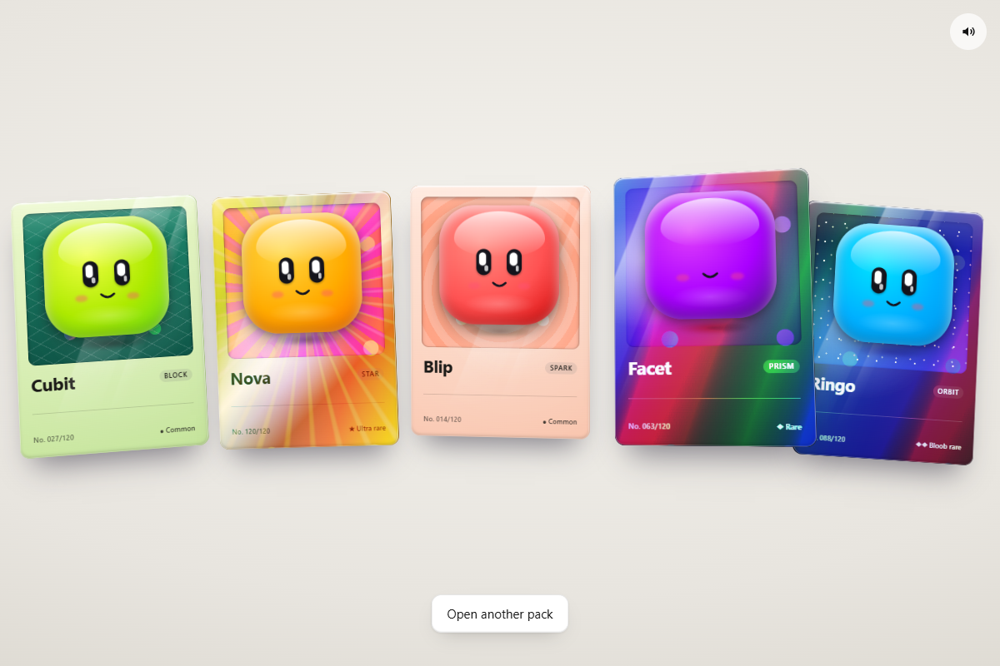
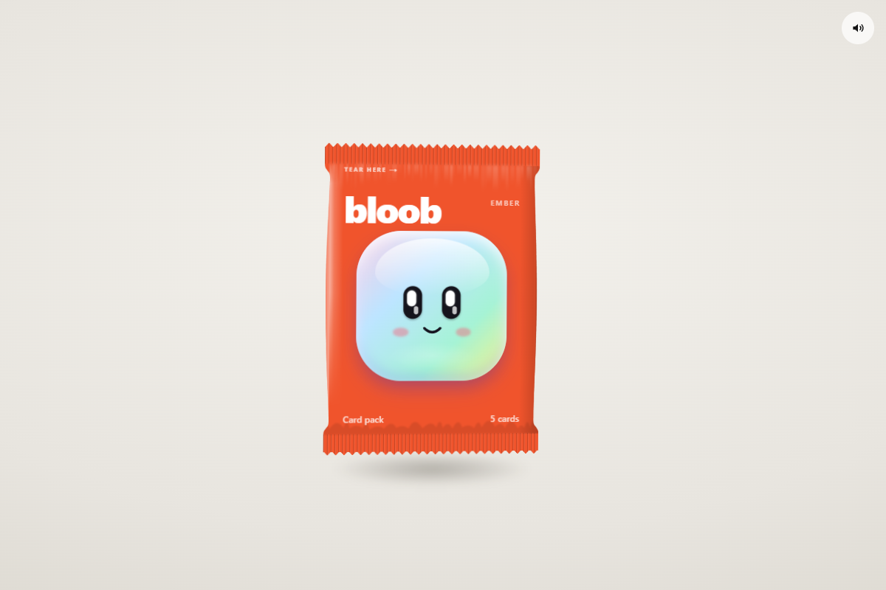
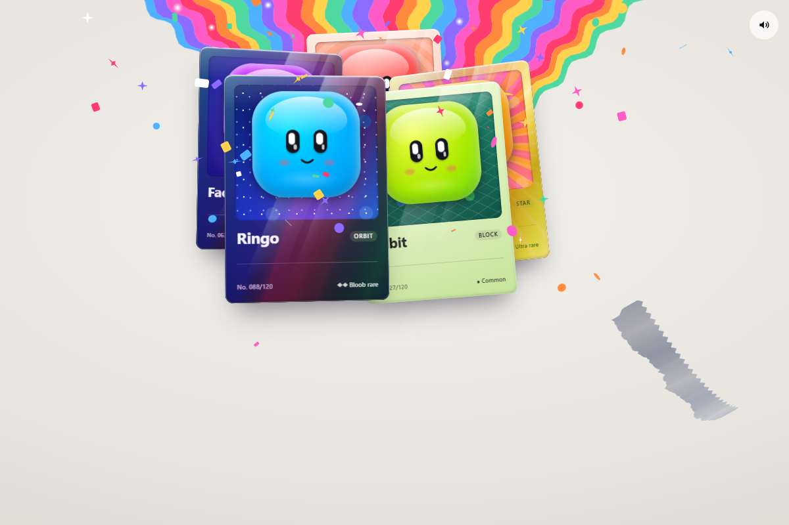

<div align="center">

# 📦 Bloob Card Pack

**Tactile 3D Tear & Unbox Trading Card Experience — Built 100% with Vanilla HTML, CSS & Web Audio API.**

[](https://alimkhalelov.github.io/bloob-card-pack/)
[](https://alimkhalelov.github.io/bloob-card-pack/)
[](https://alimkhalelov.github.io/bloob-card-pack/)
[](LICENSE)

<br/>

👉 **[Launch Interactive Live Demo](https://alimkhalelov.github.io/bloob-card-pack/)** 👈

<br/>



</div>

---

## ✨ Features & Mechanics

* ✂️ **Physical Tear-Strip Physics (Tear Here →):**
  * Grab the top perforated strip and drag across — the packaging crumples, the foil stretches, and the strip curls in 3D space (`perspective: 1400px`, `transform-style: preserve-3d`).
  * Or click once for automated kinematic tearing.
* 🌈 **Explosive Unboxing Burst:**
  * When torn open, dynamic rainbow rays shoot upward, paper confetti tumbles in 3D, and the 5 cards fan out gracefully onto the stage.
* 🎴 **3D Interactive Holographic Cards:**
  * Hover or drag across any unboxed card to inspect it with real-time 3D tilt, specular glare, and chromatic rainbow sheen.
* 🧸 **Chibi Squircle Characters ("Bloobs"):**
  * Symmetrical, superellipse squircle vinyl toy design for every collectible creature:
    * **Bloob** — Pearlescent pastel holographic mascot
    * **Blip** — Juicy coral strawberry squircle
    * **Cubit** — Electric neon lime squircle
    * **Facet** — Royal amethyst purple gem squircle
    * **Ringo** — Deep celestial cyan squircle
    * **Nova** — Solar honey star squircle
  * Vertical capsule stadium eyes with dual specular gloss highlights and Sanrio-style curved smiles.
* 🔊 **Procedural Web Audio API Sound Engine:**
  * **Zero audio files (`.mp3` / `.wav`):** Every sound effect is synthesized mathematically in real-time!
  * White noise buffer shaped through biquad bandpass and lowpass filters for foil crinkling.
  * Frequency-modulated oscillators synthesize character vocalizations (*"eep!"* on tear, *"phew!"* on release, chime notes on rare card landing).
* 🔄 **Infinite Unboxing Loop:**
  * Hit *"Open another pack"* to dynamically generate a new random foil colorway (*Cobalt, Pine, Ember, Grape, Night, Bubblegum*) with new randomized card rarities (*Common, Rare, Bloob rare, Ultra rare*).

---

## 📸 Screenshots

| 1. Unopened Pouch | 2. Tear Strip & Rainbow Burst |
|:---:|:---:|
|  |  |

<div align="center">
  <br/>
  <b>3. Unboxed Symmetrical Squircle Cards</b>
  <br/><br/>
  
</div>

---

## ⚡ Performance & Engineering

* **Zero External Dependencies:** No React, no Three.js, no GSAP, no Tailwind, no npm bundler. 100% self-contained in a single, lightweight HTML file (~295 KB).
* **60 FPS Hardware-Accelerated Pipeline:**
  * Frame limiter capped at 60 FPS (30 FPS when idle) prevents runaway refresh loops on 120Hz/144Hz/240Hz monitors.
  * Capped physics substepping (`Math.min(4, ...)`) eliminates frame drops and lag death spirals.
  * Hardware-accelerated CSS 3D transforms (`translateZ`, `rotateX/Y/Z`) with optimized 2D canvas particle batching.
* **100% Offline & Private:** Zero tracking cookies, zero external font requests, zero analytics beacons.

---

## 🚀 Running Locally

### Option 1: Double Click
Simply double-click `index.html` in your file explorer. It opens directly in Chrome, Edge, Safari, or Firefox without any server required!

### Option 2: Local HTTP Server
```bash
# Using Python
python -m http.server 3000
# Open http://localhost:3000

# Using Node.js
npx serve .
```

---

## 📜 Credits & Inspiration

* Original tear card concept & 3D pack math inspired by [Yash Bharadwaj (@Yassshhu)](https://twitter.com/Yassshhu) on [holo.yashb.xyz](https://holo.yashb.xyz/).
* Bloob edition re-engineered with symmetrical squircle characters, vertical capsule eyes, 60 FPS performance optimizations, and zero-telemetry packaging.

---

<div align="center">
  Made with ❤️ by <a href="https://github.com/alimzhankhalelov">Alimzhan Khalelov</a>
</div>
